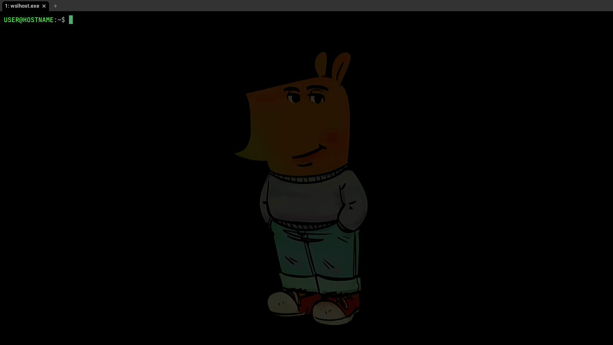

# What is this?

This is my whole terminal setup — simple as that.

## What software do I use?

- Windows is my main operating system, with the [WSL](https://learn.microsoft.com/windows/wsl/about "WSL") (Windows Subsystem for Linux) serving as my main Linux environment. WSL mounts the Windows drives, allowing me to work seamlessly with both Linux and Windows files. I use Ubuntu inside WSL, although the Linux distribution isn't particullary important.

- [WezTerm](https://wezterm.org/ "WezTerm") is my main terminal emulator.

- [Vim](https://www.vim.org/ "Vim") and [Neovim](https://neovim.io/ "Neovim") are the text editors I use in different scenarios.

## What is this config intended for?

I have preferences mainly about the key bindings. I prefer Windows key bidings instead of Linux or Vim ones because I am used to it and due to a personal standarization. For example, I prefer copy and paste text using Ctrl+c and Ctrl+v instead of the Linux or Vim ways. So the config is mainly intended to replicate the Windows key bindings in my environment.

# My terminal setup

- [WezTerm](WezTerm-config/README.md)

- [Vim](Vim-config/README.md)

- [Neovim](Neovim-config/README.md)

## Setup step by step

If you want to have my exact setup, follow the next steps. The only requisite is a computer.

1. If you are on Windows, I recommend installing the latest stable version of [WSL](https://learn.microsoft.com/windows/wsl/install "WSL") if you don't already have it, and setting up a virtual Linux environment. You can search for a tutorial to do this. If you are using Linux or MacOS, you can skip this step.

2. [Follow these steps to setup my WezTerm config](WezTerm-config/README.md).

3. [Follow these steps to setup my Vim config](Vim-config/README.md).

4. [Follow these steps to setup my Neovim config](Neovim-config/README.md).

5. There you go, enjoy!

## Why did I decide to set up my config this way?

If you want to know the 'why' behind my setup and decision-making, read this [discussion](Discussion/README.md).